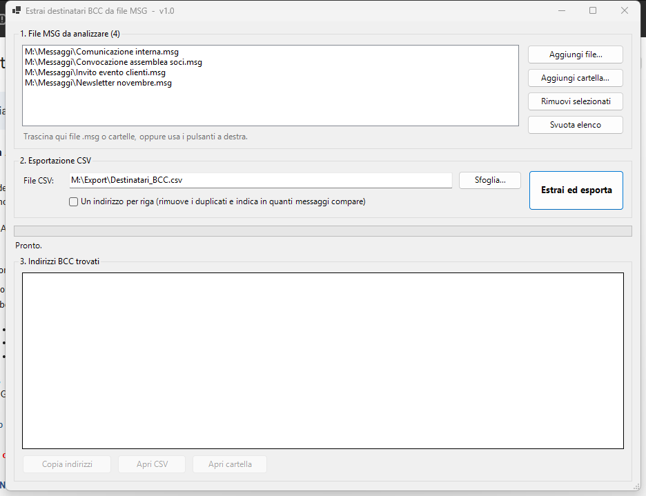
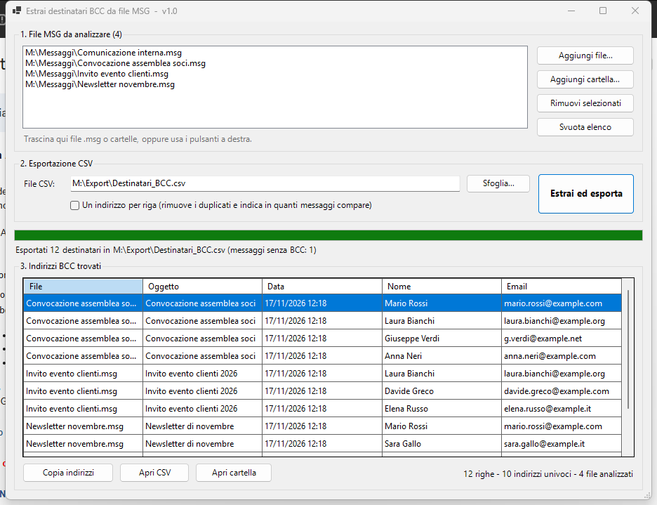
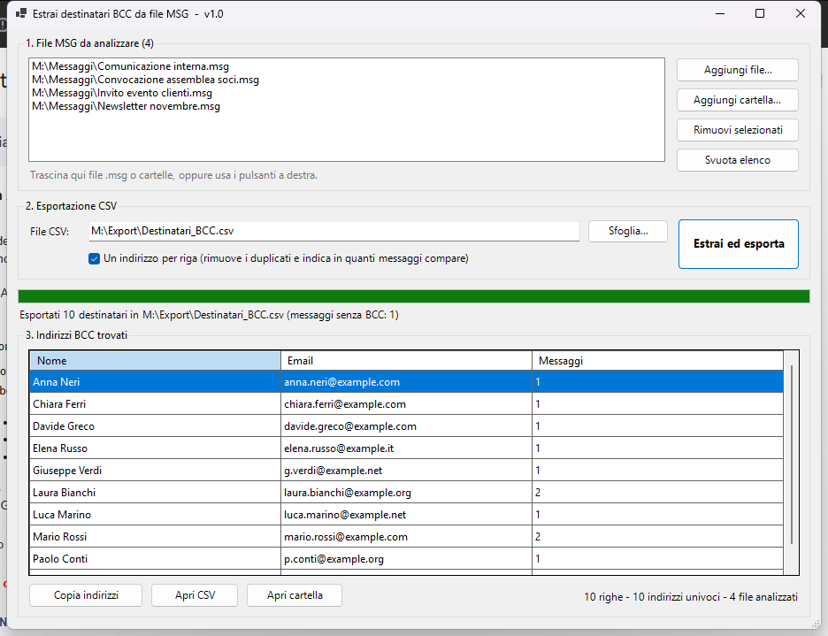

# Outlook - Estrai BCC da MSG

Script PowerShell con interfaccia grafica che estrae i destinatari in **copia nascosta (BCC / CCN)** da uno o più messaggi Outlook salvati come file `.msg`, li esporta in CSV e li mostra a video.

> Versione corrente: **1.0** – [registro revisioni](CHANGELOG.md)

## Anteprima

> Screenshot con **messaggi dimostrativi** (nomi e indirizzi fittizi su domini `example.*`).

**Caricamento dei file e scelta del CSV**



**Risultato: destinatari BCC per messaggio, esportati nel CSV**



**Opzione "un indirizzo per riga"**: duplicati uniti, con il numero di messaggi in cui compare ogni indirizzo



## Come si usa

1. Avviare lo script (doppio clic su un collegamento oppure `.\Estrai-BCC.ps1`).
2. **Caricare i file `.msg`**:
   - *Aggiungi file...* – selezione multipla di file;
   - *Aggiungi cartella...* – tutti i `.msg` di una cartella (con richiesta se includere le sottocartelle);
   - **trascinando** file e cartelle nella finestra;
   - *Rimuovi selezionati* (o tasto Canc) e *Svuota elenco* per correggere la lista.
3. **Scegliere il file CSV** con *Sfoglia...* (predefinito: `Documenti\Destinatari_BCC_<data>.csv`) ed eventualmente l'opzione *Un indirizzo per riga*.
4. Premere **Estrai ed esporta**: i messaggi vengono letti tramite Outlook, il CSV viene salvato e gli indirizzi compaiono nella tabella.
5. Dalla tabella:
   - *Copia indirizzi* – copia negli appunti gli indirizzi univoci separati da `;` (pronti da incollare in un messaggio);
   - *Apri CSV* / *Apri cartella*;
   - selezionando righe della tabella e premendo Ctrl+C si copiano le righe con intestazione.

### Contenuto del CSV

Separatore `;`, codifica UTF-8 (apribile direttamente con Excel).

| Modalità | Colonne |
| --- | --- |
| Predefinita (una riga per destinatario e messaggio) | `File`, `Oggetto`, `Data`, `Nome`, `Email` |
| Un indirizzo per riga | `Nome`, `Email`, `Messaggi` (numero di messaggi in cui compare) |

Per i destinatari Exchange (indirizzi interni di tipo `EX`) viene ricavato l'indirizzo SMTP primario.

## Requisiti

- Windows con **Microsoft Outlook desktop** installato e con un profilo configurato (lo script usa Outlook per leggere i `.msg`). Il nuovo Outlook per Windows non è supportato perché non espone l'automazione COM.
- Windows PowerShell 5.1 o PowerShell 7.
- Non servono privilegi di amministratore.

Se Outlook non è aperto viene avviato in background e chiuso al termine; se è già aperto resta aperto.

## Utilizzo da riga di comando

```powershell
# Interfaccia grafica
.\Estrai-BCC.ps1

# Interfaccia con i file di una cartella (e sottocartelle) già caricati
.\Estrai-BCC.ps1 -Path 'D:\Messaggi' -Recurse

# Senza interfaccia: un indirizzo per riga, CSV nel percorso indicato
.\Estrai-BCC.ps1 -Path 'D:\Messaggi' -OutputCsv 'D:\Export\BCC.csv' -Univoci -NoGui
```

Se lo script è stato scaricato da Internet potrebbe essere necessario sbloccarlo: `Unblock-File .\Estrai-BCC.ps1`.

### Parametri

| Parametro | Predefinito | Descrizione |
| --- | --- | --- |
| `-Path` | – | File `.msg` o cartelle da caricare all'avvio |
| `-Recurse` | – | Con le cartelle di `-Path` include le sottocartelle |
| `-OutputCsv` | `Documenti\Destinatari_BCC_<data>.csv` | Percorso del CSV (nell'interfaccia è il valore proposto) |
| `-Univoci` | – | Un indirizzo per riga, senza duplicati |
| `-NoGui` | – | Esecuzione senza interfaccia (richiede `-Path`) |

Guida integrata: `Get-Help .\Estrai-BCC.ps1 -Full`.

## Note

- **Il BCC è presente solo nei messaggi inviati**: i `.msg` salvati dalla cartella *Posta inviata* (o le bozze) contengono i destinatari in copia nascosta; i messaggi **ricevuti** non li contengono mai, per come funziona la posta elettronica. I messaggi senza BCC vengono conteggiati nella barra di stato.
- Lo script è in sola lettura: apre i `.msg`, li chiude senza salvare e non invia nulla.
- Se Outlook mostra l'avviso *"Un programma sta tentando di accedere agli indirizzi di posta elettronica"*, l'antivirus non risulta aggiornato per Outlook: consentire l'accesso oppure verificare le impostazioni del *Centro protezione → Accesso a livello di programmazione*.
- Il CSV contiene indirizzi e-mail (dati personali): conservarlo e condividerlo nel rispetto del GDPR.

## Revisioni

Vedi [CHANGELOG.md](CHANGELOG.md). Le versioni pubblicate sono disponibili nelle [release](https://github.com/vischio96/Powershell-Toolkit/releases) con tag `outlook-bcc-extract-v<versione>`.
