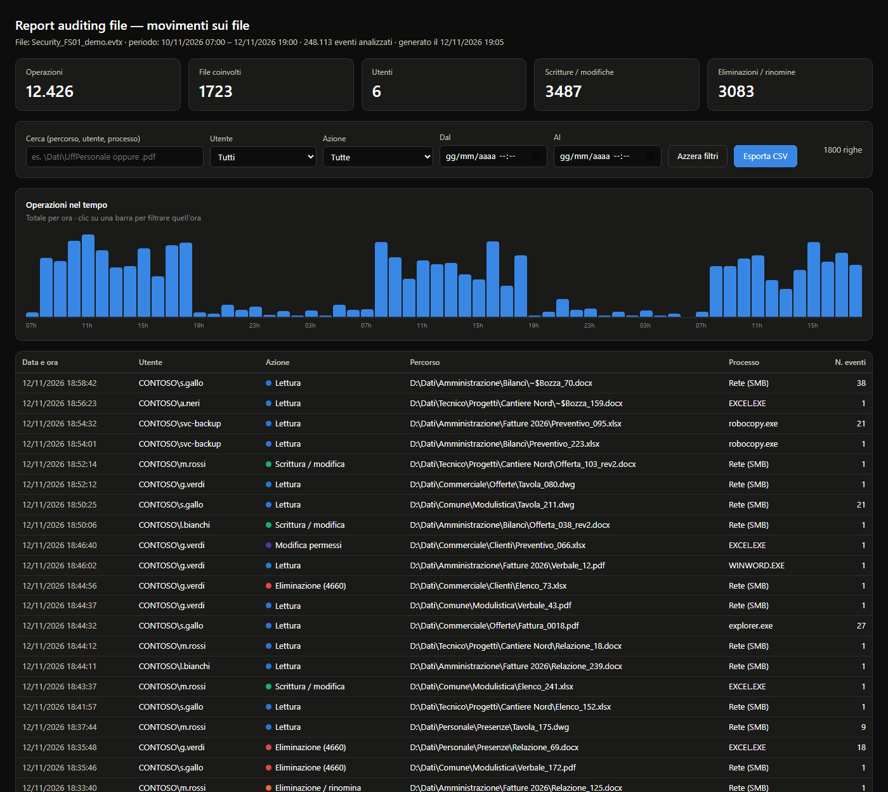
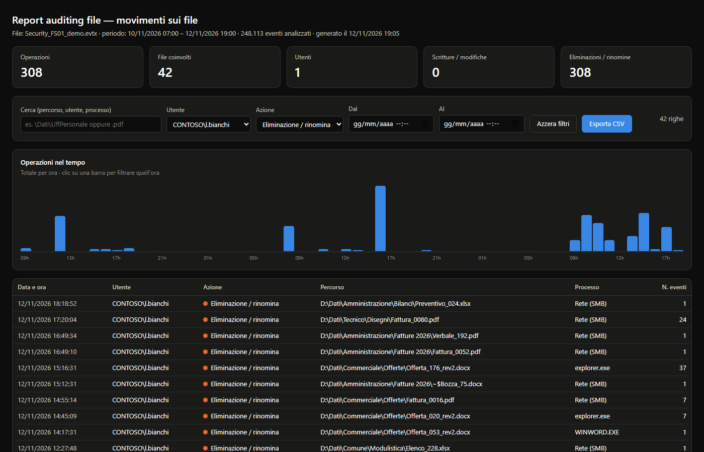

# Report auditing file

Script PowerShell **in sola lettura** che analizza un log di sicurezza di Windows (`.evtx`) di un file server e genera un report HTML interattivo dei movimenti sui file: chi ha letto, modificato, eliminato, rinominato o cambiato i permessi di quali file, e quando.

> Versione corrente: **1.0** – [registro revisioni](CHANGELOG.md)

## Anteprima

> Screenshot generati con **dati dimostrativi** (dominio, utenti e percorsi fittizi).

**Panoramica: indicatori, timeline e dettaglio delle operazioni**



**Filtri per utente e azione** (es. eliminazioni/rinomine di un singolo utente)



## Cosa fa

- Legge gli eventi **4663** (accesso a un oggetto) e **4660** (oggetto eliminato) da un file `.evtx` oppure dal log Security attivo del server.
- Classifica ogni accesso in base all'`AccessMask`:

  | Azione | Accesso richiesto |
  | --- | --- |
  | Lettura | `ReadData` (0x1) |
  | Scrittura / modifica | `WriteData` / `AppendData` (0x2, 0x4) |
  | Eliminazione / rinomina | `DELETE` (0x10000) |
  | Eliminazione (4660) | evento 4660, percorso ricavato dal 4663 con lo stesso `HandleId` |
  | Modifica attributi | `WriteAttributes` / `WriteEA` (0x100, 0x10) |
  | Modifica permessi | `WRITE_DAC` / `WRITE_OWNER` (0x40000, 0x80000) |
  | Esecuzione | `Execute` (0x20) |
  | Lettura metadati | `ReadAttributes`, `ReadEA`, `READ_CONTROL` (solo con `-IncludiMetadati`) |

- **Raggruppa** gli eventi identici (stesso utente, percorso, azione e processo nello stesso minuto) in una sola riga con il numero di eventi: il report resta leggibile anche con milioni di eventi.
- Indica il processo che ha fatto l'accesso; gli accessi via rete senza processo locale compaiono come `Rete (SMB)`.

### Il report HTML

- Indicatori: operazioni, file coinvolti, utenti, scritture/modifiche, eliminazioni/rinomine (si aggiornano con i filtri).
- Ricerca libera su percorso, utente e processo (es. `.pdf` o `\Amministrazione\`).
- Filtri per utente, azione e intervallo di date.
- Timeline per ora (periodi fino a 72 ore) o per giorno; clic su una barra per filtrare quel periodo.
- Tabella ordinabile per colonna, paginata (100 righe per pagina).
- Esportazione CSV delle righe filtrate (separatore `;`, UTF-8).
- File unico, senza dipendenze esterne, apribile offline; tema chiaro/scuro automatico.

## Requisiti

- Windows PowerShell 5.1 o PowerShell 7 su Windows.
- Per leggere il **log Security attivo** del server: sessione PowerShell **amministrativa**. Per un file `.evtx` esportato non servono privilegi particolari.
- La finestra di selezione richiede una sessione STA (predefinita in Windows PowerShell 5.1 e PowerShell 7). In alternativa indicare `-PercorsoEvtx`.
- **Auditing abilitato sul file server**, altrimenti gli eventi 4663/4660 non vengono generati:
  1. criterio *Configurazione computer → Criteri → Impostazioni di Windows → Impostazioni di sicurezza → Configurazione avanzata dei criteri di controllo → Accesso oggetti → **Controlla file system*** = Operazione riuscita (verifica: `auditpol /get /subcategory:"{0CCE921D-69AE-11D9-BED3-505054503030}"`);
  2. **SACL** sulle cartelle da controllare (*Proprietà → Sicurezza → Avanzate → Controllo*), ad esempio `Everyone` / `Domain Users` con *Crea file/scrivi dati*, *Elimina*, *Elimina sottocartelle e file*, *Modifica autorizzazioni* e, se interessa, *Visualizza cartella/leggi dati*;
  3. dimensione del log Security adeguata al volume (o archiviazione automatica dei log).

## Utilizzo

```powershell
# Finestra di selezione: log Security attivo oppure file .evtx
.\Analizza-Evtx.ps1 -ApriReport

# File .evtx esportato o archiviato
.\Analizza-Evtx.ps1 -PercorsoEvtx 'D:\Log\Security-Archivio.evtx' -ApriReport

# Solo modifiche (scritture, eliminazioni, rinomine, permessi), senza letture
.\Analizza-Evtx.ps1 -PercorsoEvtx .\log.evtx -EscludiLetture

# Report in una cartella specifica, includendo anche le letture di metadati
.\Analizza-Evtx.ps1 -PercorsoEvtx .\log.evtx -PercorsoReport 'D:\Report\Audit_FS01.html' -IncludiMetadati
```

Per esportare il log di un server senza copiare il file bloccato:

```powershell
wevtutil epl Security D:\Log\Security_FS01.evtx "/q:*[System[(EventID=4663 or EventID=4660)]]"
```

Se lo script è stato scaricato da Internet potrebbe essere necessario sbloccarlo: `Unblock-File .\Analizza-Evtx.ps1`.

### Parametri

| Parametro | Predefinito | Descrizione |
| --- | --- | --- |
| `-PercorsoEvtx` | finestra di selezione | File `.evtx` da analizzare; indicando `C:\Windows\System32\winevt\Logs\Security.evtx` viene letto il log attivo tramite il canale Security |
| `-PercorsoReport` | `.\Report_FileAudit.html` | Percorso del report HTML |
| `-IncludiMetadati` | – | Include le letture di attributi/permessi (molto numerose, di solito non interessanti) |
| `-EscludiLetture` | – | Esclude anche le letture dei dati: restano solo modifiche, eliminazioni ed esecuzioni |
| `-ApriReport` | – | Apre il report nel browser al termine |

Guida integrata: `Get-Help .\Analizza-Evtx.ps1 -Full`.

## Output

- `Report_FileAudit.html` (o il percorso indicato) – report autonomo apribile offline.
- Riepilogo a console delle operazioni per tipo.

> Il report contiene nomi utente e percorsi dei file: conservarlo in un percorso protetto.

## Note

- Le **rinomine e gli spostamenti** generano un accesso `DELETE` sul file di origine: compaiono come "Eliminazione / rinomina". L'eliminazione effettiva è confermata dall'evento 4660.
- Un evento 4660 il cui 4663 non è presente nel file (log ruotato) compare con percorso `(percorso non risolto)`.
- Word, Excel e altri programmi Office creano file temporanei (`~$...`) e salvano tramite file di appoggio e rinomine: un singolo salvataggio può produrre più righe.
- Con log molto grandi la lettura può richiedere diversi minuti (avanzamento mostrato ogni 100.000 eventi).

## Revisioni

Vedi [CHANGELOG.md](CHANGELOG.md). Le versioni pubblicate sono disponibili nelle [release](https://github.com/vischio96/Powershell-Toolkit/releases) con tag `file-audit-report-v<versione>`.
