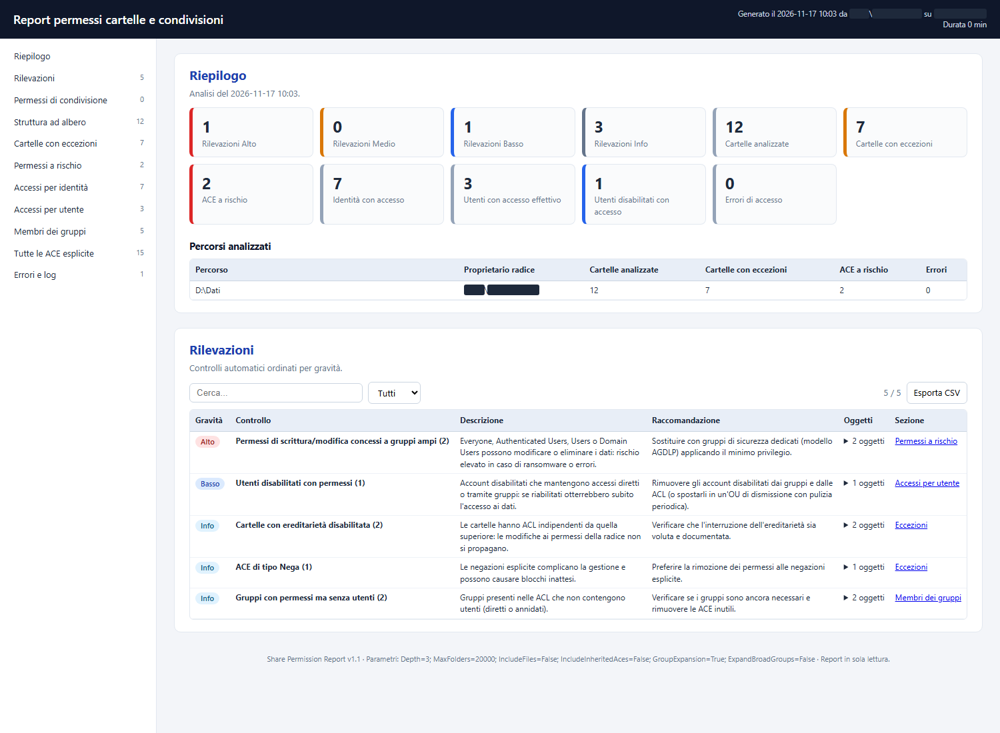
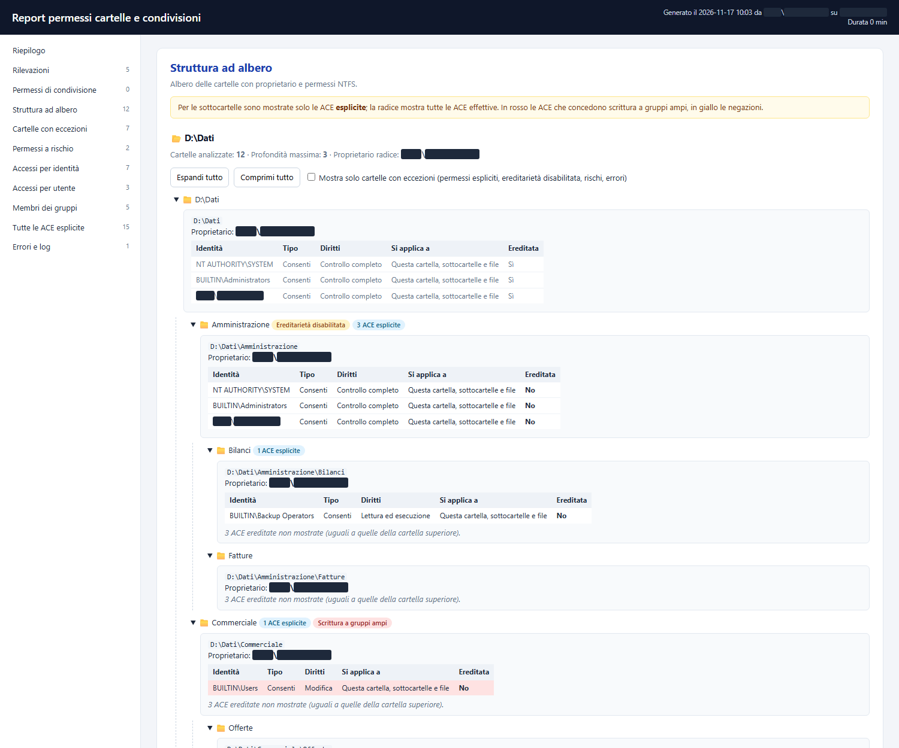
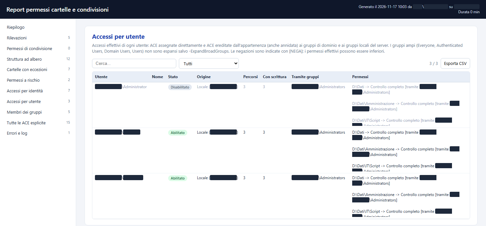
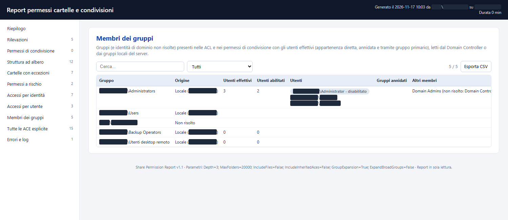

# Report permessi cartelle e condivisioni

Script PowerShell **in sola lettura** che genera un unico report HTML dei permessi NTFS e di condivisione SMB di cartelle locali, share di rete o di tutte le condivisioni di uno o più file server, con struttura ad albero e accessi effettivi per utente (gruppi espansi dal Domain Controller).

> Versione corrente: **1.1** – [registro revisioni](CHANGELOG.md)

## Anteprima

> Screenshot da un ambiente di prova: nomi di computer, dominio, account e SID sono oscurati.

**Riepilogo e rilevazioni**



**Struttura ad albero dei permessi**



**Accessi effettivi per utente** (diretti e tramite gruppi)



**Membri dei gruppi**



## Contenuto del report

| Sezione | Cosa contiene |
| --- | --- |
| Riepilogo | Indicatori principali e percorsi analizzati |
| Rilevazioni | Scrittura a gruppi ampi, lettura a Everyone, condivisioni aperte, SID orfani, ereditarietà disabilitata, negazioni, utenti disabilitati con accesso, gruppi senza utenti, errori |
| Permessi di condivisione | Permessi SMB delle condivisioni analizzate |
| Struttura ad albero | Cartelle con proprietario e ACE (esplicite o tutte), filtro "solo eccezioni" |
| Cartelle con eccezioni | Sottocartelle con permessi espliciti o ereditarietà disabilitata |
| Permessi a rischio | Scrittura a gruppi ampi, lettura a Everyone/Anonymous, negazioni, SID orfani |
| Accessi per identità | Chi ha accesso a cosa, raggruppato per utente/gruppo, con numero di utenti effettivi dei gruppi |
| **Accessi per utente** | Per ogni utente: percorsi, diritti, se l'accesso è diretto o tramite gruppo, stato abilitato/disabilitato |
| **Membri dei gruppi** | Utenti effettivi (anche annidati) dei gruppi presenti nelle ACL, di dominio e locali del server |
| File con permessi propri | Con `-IncludeFiles` |
| Tutte le ACE esplicite | Elenco piatto per ricerca ed esportazione |
| Errori e log | Oggetti non leggibili e avvisi |

### Come vengono espansi i gruppi

- **Gruppi di dominio**: query LDAP al Domain Controller (ADSI, senza RSAT) con la regola `LDAP_MATCHING_RULE_IN_CHAIN`, che restituisce anche gli utenti dei gruppi annidati; sono inclusi gli utenti che hanno il gruppo come gruppo primario.
- **Gruppi locali del file server** (es. `BUILTIN\Administrators`, `Backup Operators`): letti dal server che ospita i dati tramite il provider WinNT; i gruppi di dominio contenuti vengono a loro volta espansi.
- **Membri di altri domini/foreste** (foreign security principal): risolti tramite Global Catalog quando possibile.
- **Gruppi ampi** (Everyone, Authenticated Users, Domain Users, Users, Domain Computers...) non vengono espansi per impostazione predefinita: usare `-ExpandBroadGroups` per Domain Users / Users.
- Le ACE di **negazione** sono riportate con `[NEGA]`: l'elenco "Accessi per utente" mostra i permessi assegnati, non il calcolo dei permessi effettivi.

## Requisiti

- Windows PowerShell 5.1 o PowerShell 7 su Windows.
- Diritti di lettura delle ACL sui percorsi analizzati (es. amministratore del file server).
- Per i permessi di condivisione remoti (`-ComputerName` o percorsi UNC): accesso CIM/WinRM al file server.
- Per l'espansione dei gruppi di dominio: computer membro del dominio con un Domain Controller raggiungibile (LDAP 389). Il modulo ActiveDirectory **non** è necessario.
- Per i gruppi locali di un file server remoto: accesso RPC/SMB al server (provider WinNT).

## Utilizzo

```powershell
# Selezione della cartella da finestra di dialogo
.\Get-SharePermissionReport.ps1 -OpenReport

# Una condivisione, 4 livelli di profondità
.\Get-SharePermissionReport.ps1 -Path '\\FS01\Dati' -Depth 4 -OpenReport

# Tutte le condivisioni di due file server, con CSV
.\Get-SharePermissionReport.ps1 -ComputerName FS01,FS02 -Depth 3 -ExportCsv

# Percorso locale, controllando anche i file e mostrando le ACE ereditate
.\Get-SharePermissionReport.ps1 -Path 'D:\Condivisioni' -IncludeFiles -IncludeInheritedAces

# DC specifico ed espansione anche di Domain Users / Users
.\Get-SharePermissionReport.ps1 -Path '\\FS01\Dati' -DomainController DC01.contoso.local -ExpandBroadGroups

# Senza interrogare il Domain Controller
.\Get-SharePermissionReport.ps1 -Path '\\FS01\Dati' -SkipGroupExpansion
```

### Parametri

| Parametro | Predefinito | Descrizione |
| --- | --- | --- |
| `-Path` | finestra di selezione | Uno o più percorsi locali o UNC |
| `-ComputerName` | – | File server di cui analizzare tutte le condivisioni disco |
| `-IncludeAdminShares` | – | Con `-ComputerName` include anche `C$`, `ADMIN$`, ... |
| `-Depth` | 5 | Profondità massima delle sottocartelle |
| `-MaxFolders` | 20000 | Numero massimo di cartelle analizzate |
| `-IncludeInheritedAces` | – | Mostra nell'albero anche le ACE ereditate |
| `-IncludeFiles` | – | Controlla anche i file (più lento) |
| `-MaxFiles` | 100000 | Numero massimo di file controllati |
| `-SkipGroupExpansion` | – | Non espande i gruppi |
| `-DomainController` | automatico | DC (o dominio) da interrogare per l'espansione dei gruppi |
| `-ExpandBroadGroups` | – | Espande anche Domain Users, Users, Domain Computers... |
| `-OutputFolder` | cartella dello script | Cartella del report |
| `-ExportCsv` | – | Esporta i dati in CSV (separatore `;`, UTF-8) |
| `-OpenReport` | – | Apre il report al termine |

Guida integrata: `Get-Help .\Get-SharePermissionReport.ps1 -Full`.

## Output

- `Report_Permessi_<data>.html` – report autonomo apribile offline.
- `Report_Permessi_<data>_csv\` – con `-ExportCsv` (ACE, eccezioni, permessi di condivisione, accessi per identità, accessi per utente, membri dei gruppi, file, rilevazioni).

> Il report contiene nomi di utenti, gruppi e percorsi: conservarlo in un percorso protetto.

## Revisioni

Vedi [CHANGELOG.md](CHANGELOG.md). Le versioni pubblicate sono disponibili nelle [release](https://github.com/vischio96/Powershell-Toolkit/releases) con tag `share-permission-report-v<versione>`.
